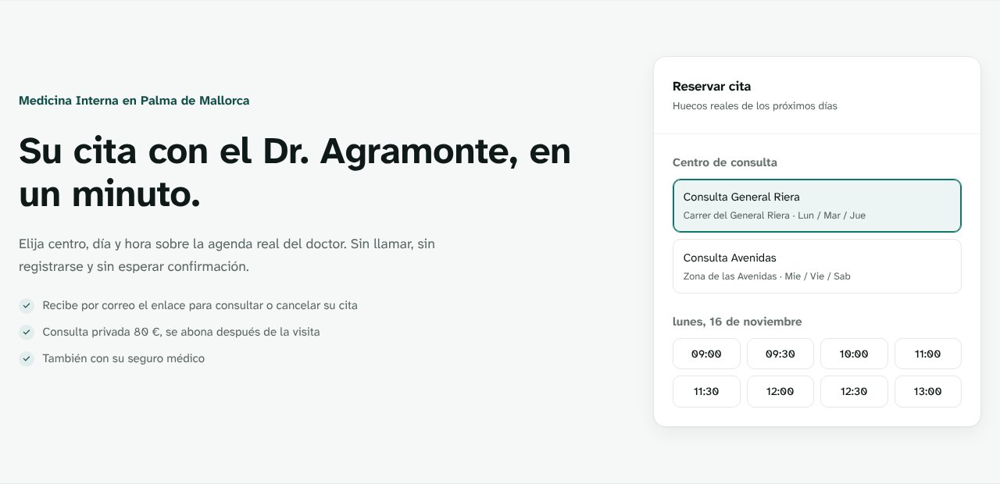
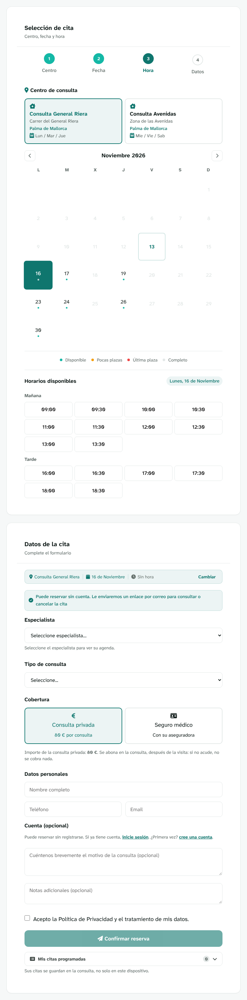

# Dr. Agramonte

[Español](README.md) · **English**

Appointment booking for a real internal medicine practice in Palma de Mallorca. Patients
book, check and cancel their appointments on their own, without having to phone.

`Java 21` · `Spring Boot 3.5` · `PostgreSQL 15` · `JavaScript` · `Docker` · `Caddy`

[](https://github.com/maragramonte/dr-agramonte/actions/workflows/ci.yml)



> The app is in Spanish and Catalan, and so are the code and the detailed documentation.
> This page is the short version for anyone who doesn't read them.

---

## Why I built it

A lot of the calls a doctor gets outside surgery hours aren't emergencies. They're people
moving an appointment, asking about a free slot or cancelling, and nobody pays for that time.

The app takes care of exactly that part. It's meant for a private practice or a small clinic,
with one or more doctors and locations, that runs its diary by phone or on paper today.

I decided you should be able to book without creating an account. If you have to sign up to
get an appointment, plenty of people end up phoning anyway.

---

## Try it

[Live demo](https://maragramonte.github.io/dr-agramonte/): a product page and, under
[`/app/`](https://maragramonte.github.io/dr-agramonte/app/), the real application running
against an API simulated in the browser.

> **It's a simulation, not a server.** The data is fictional, it lives in your browser and no
> real notification is sent. What the demo **can't** show (concurrency, availability computed
> on the server and role-based access control) is explained in [docs/DEMO.md](docs/DEMO.md)
> (Spanish).

**The one-minute tour:** in `/app/`, press "Entrar como paciente" and book an appointment.
Then "Entrar como médico" to see it in the diary and on the dashboard.

> **Deployment.** The public version is the demo. The self-hosted deployment is ready and
> tested, waiting for the server to be set up ([docs/DESPLIEGUE-VPS.md](docs/DESPLIEGUE-VPS.md)).

---

## What it does

Everything below is implemented in the backend and works against a real database:

- **Booking without an account**, or with one: location → date → time → details.
- **Real availability**, computed on the server and split by location and day.
- **Private or insured**: private visits show their price; insured patients pick their
  insurer.
- **Automatic notifications** for confirmation, cancellation and a reminder 24 hours before,
  by email, Telegram and SMS/WhatsApp. Anyone who books without an account gets an email
  link to check or cancel the appointment from any device.
- **Dashboard** for the doctor: workload per doctor, demand per specialty, split by location
  and cancellation rate.
- **Bilingual** Spanish/Catalan, with the choice remembered in the browser.
- **Installable PWA**, accessible (WCAG 2.1 AA), with dark mode and an offline mode.

The three notification channels are **optional**: without their credentials the app works
the same, it just doesn't send messages.



---

## Architecture

```
[Browser]  →  [Caddy]  →  HTTPS with Let's Encrypt, apex → www
                              ↓
                     [Spring Boot]  →  [PostgreSQL]
                              ↓
                   [Twilio]   [Telegram]
```

In production, Caddy terminates HTTPS in front of a single container where Spring Boot serves
both the API and the frontend. PostgreSQL publishes no port outside the internal network.

The backend uses classic layers (controller · service · repository) with DTOs kept apart from
the entities. The frontend is static, with no framework and no build step, and nothing loads
from a CDN: fonts, icons and Chart.js are self-hosted, which allows a Content-Security-Policy
**without `'unsafe-inline'` for scripts**.

---

## Technical decisions

**Pessimistic locking against double booking.** Booking locks the slot row with
`SELECT ... FOR UPDATE` on a `UNIQUE (medico_id, inicio)` index. The first transaction wins;
the second gets a **409** and nothing is saved. A test fires two threads synchronised with a
`CyclicBarrier` at the same slot, against a real PostgreSQL started by Testcontainers, and
checks that exactly one 201 and one 409 come back.

**Notifications go out after the commit.** They're deferred to the `afterCommit` phase. No
network call happens while a row is locked, and if the transaction rolls back nobody is told
about an appointment that never existed.

**The URL doesn't decide whose diary you see.** `/api/citas/agenda/**` used to take the
doctor as a parameter with `defaultValue = "1"`. The role was checked properly, but nobody
checked *which* doctor, so changing the number was enough to read someone else's diary. No
role test catches that, because the role was right. The doctor now comes from the JWT.

**The appointment token is hashed and lives in the fragment.** Anyone who books without an
account gets an opaque token, handed out once. The database only keeps its SHA-256, and it
travels in the URL fragment, which the browser never sends to the server.

The full reasoning, with alternatives and limitations, is in
[docs/DECISIONES-TECNICAS.md](docs/DECISIONES-TECNICAS.md) (Spanish).

---

## Tests

```bash
cd backend && mvn test
cd e2e && npm ci && npx playwright test
```

**115 backend tests** on three levels: 70 unit tests, 27 for the REST layer (`@WebMvcTest`
with the real `SecurityConfig`) and 18 integration tests against a PostgreSQL started with
Testcontainers. The email tests use GreenMail, an in-memory SMTP server: the token is pulled
out of the email that actually arrived.

Integration tests **need Docker**; without it they're marked as skipped instead of failing.
CI makes up for that: it reads the Surefire reports and **fails if any test didn't run**.
Dependencies are also scanned weekly with OWASP dependency-check.

**22 browser tests** with Playwright, on desktop and on an emulated phone, cover booking
without an account, cancelling, the email link, dashboard access for each role, switching
language, and axe-core on all nine pages. They run against the demo with the simulated API,
so they test the frontend, not its integration with the backend.

What's **not** covered: coverage isn't measured (no JaCoCo, so no percentage), no test goes
through browser and real backend in one run, dark mode isn't checked automatically, and the
MySQL profile isn't tested in CI.

---

## Running it locally

You need **Docker Desktop**. To build the backend on its own, JDK 21 and Maven 3.9+.

```bash
cp .env.example .env          # set JWT_SECRET
docker compose up -d --build
```

- Web: <http://localhost>
- API: <http://localhost:8080>

Test doctor account, created by migration V3: `dr.agramonte@example.com` / `Medico123!`. That
account is **public** (the password is in the repository); the app overwrites it on start-up
with `MEDICO_EMAIL` and `MEDICO_PASSWORD`, and the production compose file won't start
without them.

---

## About me

I'm **Mar Agramonte**, a recent graduate in Multiplatform Application Development (DAM, a
two-year higher vocational degree in Spain), based in Mallorca.

I came from office administration and moved into software by building real projects, not
just coursework. This is one of them: it started as my final-year project and keeps growing
because there's a real practice behind it.

I work with **Java, JavaScript, HTML and CSS**. I can consume and test APIs and plug external
services into an application: here that means Twilio, the Telegram Bot API and deploying to a
self-hosted server with Docker and automatic HTTPS through Caddy.

I use AI tools as active support, to learn faster, debug and get unstuck, like any junior
developer today. The technical decisions in this repository, and being able to explain them,
are mine.

I'm looking for my **first role as a junior developer**, in Mallorca or remote.

---

## Licence

© 2026 Mar Agramonte. All rights reserved.

Proprietary software: the code can be read and quoted, but not reused or adapted without
written permission. The full terms are in [LICENSE](LICENSE), and the licences of the
third-party components it includes are in [THIRD-PARTY.md](THIRD-PARTY.md). Get in touch if
you'd like a licence to use it.

Built as my final-year project (DAM, CESUR) and still evolving.
