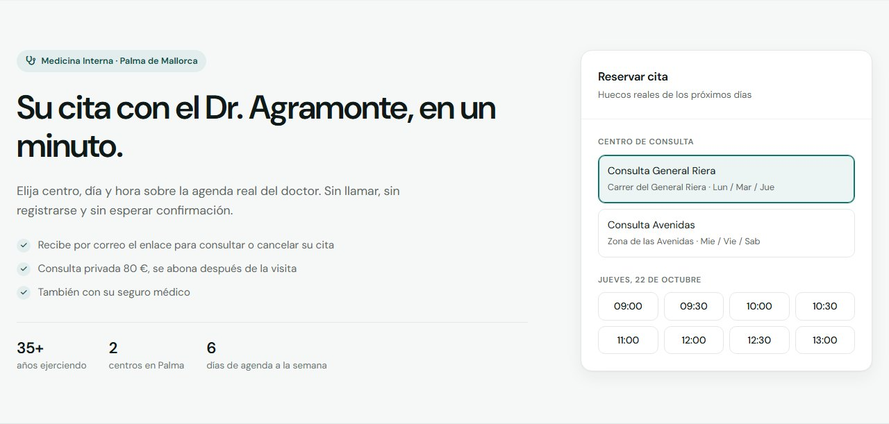
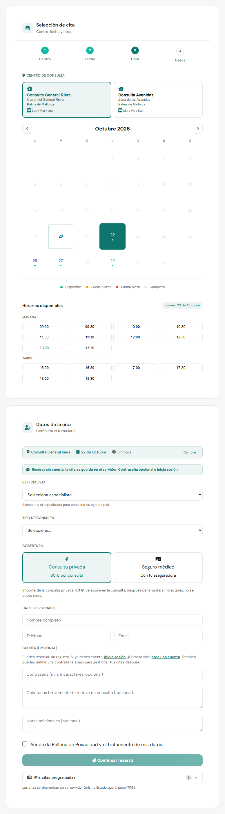

# Dr. Agramonte

Plataforma de gestión de citas médicas para la consulta de un internista real en Palma de
Mallorca. Los pacientes reservan, consultan y cancelan sus citas por su cuenta, sin depender
del teléfono.

`Java 21` · `Spring Boot 3.5` · `PostgreSQL 15` · `JavaScript` · `Docker` · `Caddy`

[](https://github.com/maragramonte/dr-agramonte/actions/workflows/ci.yml)



---

## Por qué lo hice

Muchas de las llamadas que recibe un médico fuera de horario no son urgencias. Son cambios
de hora, preguntas por un hueco o cancelaciones, y ese tiempo no lo paga nadie.

La aplicación se ocupa solo de esa parte. Está pensada para una consulta privada o una
clínica pequeña, con uno o varios médicos y centros, que hoy lleva la agenda por teléfono o
en papel.

Decidí que se pudiera reservar sin crear cuenta. Si para pedir hora hay que registrarse,
mucha gente acaba llamando igual.

---

## Probarlo

[Demo en línea](https://maragramonte.github.io/dr-agramonte/): una presentación del
producto y, bajo [`/app/`](https://maragramonte.github.io/dr-agramonte/app/), la aplicación
real con una API simulada en el navegador.

> **Es una simulación, no un servidor.** Los datos son ficticios, viven en tu navegador y no
> se envía ningún aviso de verdad. Lo que la demo **no** puede demostrar (la concurrencia, la
> disponibilidad calculada en servidor y el control de acceso por rol) está explicado en
> [docs/DEMO.md](docs/DEMO.md#qué-no-puede-demostrar).

**Para verlo en un minuto:** en `/app/`, pulsa «Entrar como paciente» y reserva una cita.
Después, «Entrar como médico» para verla en la agenda y en el cuadro de mando.

Si prefieres no pulsar nada, en [docs/CAPTURAS.md](docs/CAPTURAS.md) está la aplicación
pantalla a pantalla. La [memoria completa](docs/Memoria-Dr-Agramonte.pdf) (PDF) cuenta el
proyecto entero.

> **Estado del despliegue.** El dominio `dragramonte.com` está registrado pero **hoy no sirve
> la aplicación**: el alojamiento anterior se retiró y el despliegue en servidor propio está
> preparado y probado, a la espera de levantar la máquina
> ([docs/DESPLIEGUE-VPS.md](docs/DESPLIEGUE-VPS.md)).

---

## Qué hace

Todo lo siguiente está implementado en el backend y funciona contra una base de datos real:

- **Reserva sin registro previo** o con cuenta: centro → fecha → hora → datos.
- **Disponibilidad real** calculada en el servidor, repartida por centro y día.
- **Cobertura y pago**: consulta privada con precio visible, o seguro médico con aseguradora.
- **Avisos automáticos** de confirmación, cancelación y recordatorio 24 h antes, por correo,
  Telegram y SMS/WhatsApp. Quien reserva sin cuenta recibe en el correo el enlace para
  consultar o cancelar su cita desde cualquier dispositivo.
- **Cuadro de mando** para el profesional: carga por médico, demanda por especialidad,
  reparto por centro y tasa de cancelación.
- **Bilingüe** castellano/catalán, con la preferencia guardada en el navegador.
- **PWA instalable**, accesible (WCAG 2.1 AA), con modo oscuro y modo sin conexión.

Los tres canales de aviso son **opcionales**: con sus credenciales sin configurar la
aplicación funciona igual, simplemente no envía mensajes.



---

## Arquitectura

Dos despliegues, la misma aplicación dentro. En producción, Caddy termina el HTTPS por
delante de un único contenedor donde Spring Boot sirve la API y el frontend juntos;
PostgreSQL no publica ningún puerto fuera de la red interna.

```
[Navegador]  →  [Caddy]  →  HTTPS con Let's Encrypt, apex → www
                              ↓
                     [Spring Boot]  →  [PostgreSQL]
                              ↓
                   [Twilio]   [Telegram]
```

El backend va en capas clásicas (controlador · servicio · repositorio) con DTOs separados de
las entidades. El frontend es estático, sin framework ni paso de compilación, y nada se carga
de un CDN: tipografías, iconos y Chart.js están autoalojados, lo que permite servir una
Content-Security-Policy **sin `'unsafe-inline'` en los scripts**.

**→ [docs/ARQUITECTURA.md](docs/ARQUITECTURA.md)**: componentes, flujo de una petición,
autenticación, concurrencia, notificaciones e infraestructura.

---

## Decisiones técnicas

Las cuatro que mejor explican el proyecto. El razonamiento completo (con alternativas,
limitaciones y evidencia en el código) está en
**[docs/DECISIONES-TECNICAS.md](docs/DECISIONES-TECNICAS.md)**.

**Bloqueo pesimista contra la doble reserva.** La reserva bloquea la fila del horario con
`SELECT ... FOR UPDATE` sobre un índice `UNIQUE (medico_id, inicio)`. La primera transacción
gana; la segunda recibe un **409** sin persistir nada. Hay una prueba que lanza dos hilos
sincronizados con `CyclicBarrier` contra la misma franja, sobre un PostgreSQL real levantado
con Testcontainers, y comprueba que sale exactamente un 201 y un 409.
[→](docs/DECISIONES-TECNICAS.md#1-bloqueo-pesimista-contra-la-doble-reserva)

**Los avisos salen después del commit.** Se aplazan a la fase `afterCommit`. Así ninguna
llamada de red ocurre con una fila bloqueada, y si la transacción se revierte nunca se avisa
de una cita que no llegó a existir.
[→](docs/DECISIONES-TECNICAS.md#2-las-notificaciones-salen-después-del-commit)

**De quién es una agenda no lo decide la URL.** `/api/citas/agenda/**` recibía el médico por
parámetro con `defaultValue = "1"`: el rol se comprobaba bien, pero nadie comprobaba *qué*
médico, así que bastaba cambiar el número para leer la agenda de otro. Es un fallo que
ninguna prueba de roles detecta, porque el rol era correcto. Ahora el médico sale del JWT.
[→](docs/DECISIONES-TECNICAS.md#7-de-quién-es-una-agenda-no-lo-decide-la-url)

**El token de la cita, hasheado y en el fragmento.** Quien reserva sin cuenta recibe un token
opaco entregado una sola vez. En base de datos solo queda su SHA-256, y viaja en el fragmento
de la URL, que el navegador no manda al servidor.
[→](docs/DECISIONES-TECNICAS.md#5-token-de-acceso-por-cita-hash-en-base-de-datos-y-fragmento-en-la-url)

---

## Pruebas y calidad

```bash
cd backend && mvn test
```

**115 pruebas** en tres niveles: 70 unitarias, 27 de capa REST (`@WebMvcTest` con la
`SecurityConfig` real) y 18 de integración contra un PostgreSQL levantado con Testcontainers.
Las de correo usan GreenMail, un SMTP en memoria: el token se extrae del correo realmente
recibido.

Las de integración **necesitan Docker**; sin él se marcan como saltadas en lugar de fallar.
El CI lo compensa: revisa los informes de Surefire y **falla si alguna quedó sin ejecutar**.
Hay además análisis semanal de vulnerabilidades de dependencias con OWASP dependency-check.

Lo que **no** está cubierto, dicho sin adornos: la cobertura no está medida (no hay JaCoCo,
así que no hay porcentaje), el frontend no tiene pruebas automatizadas, no hay E2E y el
perfil MySQL no se prueba en CI.

**→ [docs/PRUEBAS-Y-CALIDAD.md](docs/PRUEBAS-Y-CALIDAD.md)**

---

## Puesta en marcha

Requiere **Docker Desktop**. Para compilar el backend por separado, JDK 21 y Maven 3.9+.

```bash
cp .env.example .env          # editar JWT_SECRET
docker compose up -d --build
```

- Web: <http://localhost>
- API: <http://localhost:8080>

Usuario médico de prueba, que crea la migración V3: `dr.agramonte@example.com` / `Medico123!`
Esa cuenta es **pública** (la contraseña está en el repositorio); la aplicación la reescribe
al arrancar con `MEDICO_EMAIL` y `MEDICO_PASSWORD`, y sin esas variables el compose de
producción no levanta.

| Para | Documento |
|------|-----------|
| Variables de entorno, canales de aviso y alta del bot de Telegram | [docs/CONFIGURACION.md](docs/CONFIGURACION.md) |
| Producción en un VPS propio: HTTPS, dominio, copias y actualizaciones | [docs/DESPLIEGUE-VPS.md](docs/DESPLIEGUE-VPS.md) |
| Cuando el arranque falla, 502 o healthchecks | [docs/DOCKER-TROUBLESHOOTING.md](docs/DOCKER-TROUBLESHOOTING.md) |

---

## Estructura del repositorio

```
.
├── backend/          API Spring Boot (controller · service · repository · DTOs)
│   └── src/main/resources/db/migration/   Flyway V1–V14 (postgresql/ y mysql/)
├── frontend/         Sitio estático, PWA y nginx.conf
├── demo/             API simulada y landing de producto para GitHub Pages
├── postman/          Colección de la API
├── scripts/          deploy.sh, backup-db.sh, build-demo.sh y capturar-pantallas.sh
├── docs/             Documentación, memoria del proyecto y diagramas
├── Caddyfile         HTTPS, apex → www y cabeceras de seguridad
├── docker-compose.yml        Local:  nginx · Spring Boot · PostgreSQL
└── docker-compose.prod.yml   VPS:    Caddy · Spring Boot (API y web) · PostgreSQL
```

---

## Documentación

| Documento | Contenido |
|-----------|-----------|
| [ARQUITECTURA.md](docs/ARQUITECTURA.md) | Cómo está construido: componentes, flujos y responsabilidades |
| [DECISIONES-TECNICAS.md](docs/DECISIONES-TECNICAS.md) | Por qué se eligió cada solución, con alternativas y limitaciones |
| [PRUEBAS-Y-CALIDAD.md](docs/PRUEBAS-Y-CALIDAD.md) | Qué se comprueba, cómo, y qué no queda cubierto |
| [API.md](docs/API.md) | Catálogo de endpoints, autenticación y códigos de estado |
| [CONFIGURACION.md](docs/CONFIGURACION.md) | Variables de entorno, canales y bot de Telegram |
| [BASE-DE-DATOS.md](docs/BASE-DE-DATOS.md) | Esquema, diagrama relacional, integridad y concurrencia |
| [SINCRONIZACION-CITAS.md](docs/SINCRONIZACION-CITAS.md) | Una sola fuente de verdad entre las tres vistas de citas |
| [DEMO.md](docs/DEMO.md) | Cómo está hecha la demo y qué no puede demostrar |
| [CAPTURAS.md](docs/CAPTURAS.md) | La aplicación pantalla a pantalla, en imágenes |
| [DESPLIEGUE-VPS.md](docs/DESPLIEGUE-VPS.md) | Puesta en producción en un servidor propio |
| [DOCKER-TROUBLESHOOTING.md](docs/DOCKER-TROUBLESHOOTING.md) | Arranque, 502 y healthchecks |
| [EVOLUCION.md](docs/EVOLUCION.md) | Cómo creció el proyecto, fase a fase |
| [Memoria-Dr-Agramonte.pdf](docs/Memoria-Dr-Agramonte.pdf) | Memoria completa del proyecto (LaTeX) |

---

## Hacia dónde va

- [ ] Pasarela de pago en línea (la cobertura y la preferencia ya se capturan)
- [ ] Panel clínico multi-centro con historial
- [ ] Refresh token
- [ ] Cobertura medida con JaCoCo y pruebas E2E
- [x] Cancelar la cita desde el propio aviso: hecho en el correo (el enlace lleva el token
      de la cita); queda hacerlo desde Telegram y SMS, y confirmar la asistencia

---

## Sobre mí

Soy **Mar Agramonte**, desarrolladora recién graduada en el Ciclo Superior de **Desarrollo de
Aplicaciones Multiplataforma**.

Vengo de administración y he hecho la transición a desarrollo construyendo proyectos reales,
no solo ejercicios de clase. Este es uno: nació como mi proyecto de fin de ciclo y sigue
creciendo porque hay una consulta de verdad detrás. Ahora mismo estoy desarrollando además
una web para un negocio real.

Trabajo con **Java, JavaScript, HTML y CSS**. Sé consumir y probar APIs e integrar servicios
externos en una aplicación: aquí están Twilio, la Bot API de Telegram y el despliegue en un
VPS propio con Docker, dominio propio y HTTPS automático con Caddy.

Uso herramientas de IA como apoyo activo (para aprender más rápido, depurar y desatascarme)
igual que cualquier desarrolladora junior hoy. Las decisiones técnicas de este repositorio, y
el saber explicarlas, son mías.

Busco mi **primera oportunidad como desarrolladora junior**, en Mallorca o en remoto, en un
equipo donde seguir creciendo y aportar desde el primer día.

---

## Licencia

© 2026 Mar Agramonte. Todos los derechos reservados.

Software propietario: el código puede leerse y citarse, pero no reutilizarse ni adaptarse sin
permiso escrito. Las condiciones completas están en [LICENSE](LICENSE), y las licencias de
los componentes de terceros que incorpora, en [THIRD-PARTY.md](THIRD-PARTY.md). Para una
licencia de uso, escríbeme.

Proyecto propio desarrollado como Trabajo de Fin de Ciclo (DAM, CESUR) y en evolución desde
entonces.
