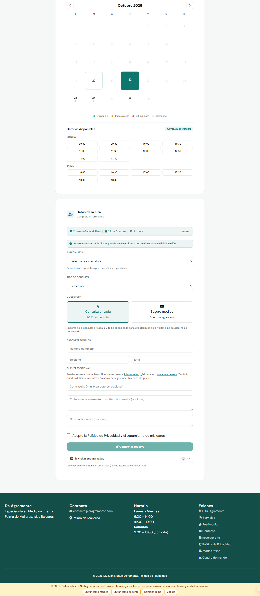
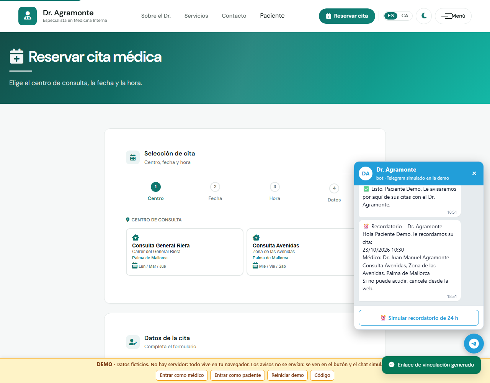
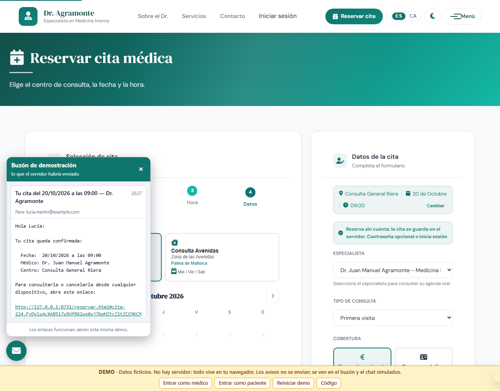
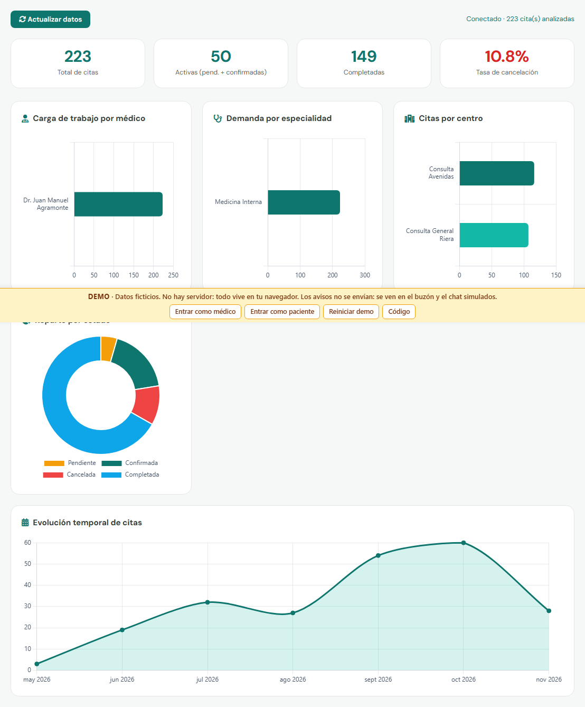

# La demo pública

**▶ <https://maragramonte.github.io/dr-agramonte/>**

Qué es, qué puede demostrar y qué no, y cómo construirla en local.

---

## Dos partes, dos públicos

| Ruta | Qué hay | Para quién |
|------|---------|------------|
| `/` | Landing de producto ([`demo/landing/`](../demo/landing/)) | Quien evalúa la aplicación y necesita saber qué hace antes de tocarla |
| `/app/` | La web del doctor tal cual, con la API simulada | Quien quiere probarla |

La separación existe porque la web del doctor está escrita para sus pacientes y no explica
nada de sí misma. Antes la demo era solo eso, así que quien llegaba a evaluarla aterrizaba
en la consulta de un internista de Palma sin contexto.

**Para probarla en un minuto:** en `/app/`, pulsa «Entrar como paciente» en la franja
amarilla y reserva una cita. Después pulsa «Entrar como médico» para verla en la agenda y en
el cuadro de mando.

---

## Cómo está hecha

La parte de `/app/` **no es una maqueta aparte**: son las mismas páginas y el mismo
`api-client.js` de `frontend/`. Lo único que cambia es
[`demo/demo-api.js`](../demo/demo-api.js), que intercepta `fetch('/api/...')` y responde con
los mismos contratos JSON que los DTOs del backend.

Reproduce sus reglas: la agenda por centro de la migración V6, el 409 por hueco ocupado y el
401/403 por rol. Los datos ficticios viven en el `localStorage` del visitante y se regeneran
cada día. La franja amarilla de abajo, con los accesos directos, es lo único que la demo
añade a la interfaz real.



### Telegram

Funciona contra un chat simulado en la propia página en vez del bot real. La vinculación usa
un token de un solo uso con quince minutos de validez; al pulsar «Iniciar» pasa lo mismo que
con `/start <token>` en el webhook. A partir de ahí llegan la confirmación, la cancelación y
el recordatorio, con los textos exactos de `CitaNotificationService`.



### El buzón de correo

Abajo a la izquierda. Recoge los cuatro correos que manda el backend (activación de cuenta,
enlace de acceso al reservar, recordatorio de la víspera y comprobante de cancelación) con
sus textos exactos.

Sus enlaces **se pueden pulsar**, porque apuntan a las páginas de la propia demo: al abrir el
de una cita, el token se importa en ese navegador y la cita aparece en «Mis citas», que es
justo el camino que el correo resuelve en producción.



### El cuadro de mando

Entrando como médico. La demo agrega las citas ficticias igual que el backend agrega las
reales con `GROUP BY`.



---

## Qué NO puede demostrar

Esto conviene tenerlo delante antes de sacar conclusiones de la demo:

| No demuestra | Por qué |
|--------------|---------|
| **La concurrencia** | El bloqueo pesimista solo existe contra PostgreSQL. Para eso están las [pruebas de integración](PRUEBAS-Y-CALIDAD.md) |
| **La disponibilidad calculada en servidor** | Aquí la calcula el propio navegador |
| **El control de acceso por rol** | No hay backend que lo imponga; la simulación devuelve los 401/403 por imitación |
| **El envío real de avisos** | Ningún correo, SMS ni mensaje de Telegram sale de verdad |
| **La persistencia** | Todo vive en el `localStorage` de esa pestaña. Si se vacían los datos del sitio, desaparece |

Los datos de pacientes y médicos son **ficticios**. No hay información personal real en la
demo.

---

## Construirla en local

```bash
./scripts/build-demo.sh                      # genera dist-demo/ (landing + app/)
python3 -m http.server -d dist-demo 8000     # http://localhost:8000
```

El script copia `frontend/` a `app/` e inyecta la API simulada. También quita el service
worker, que precachea rutas absolutas y en Pages el sitio vive bajo `/dr-agramonte/`, y
marca con `noindex` las once páginas de la aplicación para que no compitan con el dominio
real. `frontend/` no se toca, así que la imagen de producción nunca lleva el modo demo.

Cada push a `main` que afecte al frontend o a `demo/` la publica con
[`.github/workflows/demo.yml`](../.github/workflows/demo.yml). En los pull request solo se
construye, sin desplegar.

---

## Cómo presentar el proyecto: comparativa

El repositorio tiene hoy tres formas de enseñar la aplicación sin instalar nada. Esta es la
valoración de cada una.

| Criterio | Demo interactiva | Capturas ([CAPTURAS.md](CAPTURAS.md)) | Vídeo de 60–90 s |
|----------|------------------|----------------------------------------|------------------|
| Esfuerzo del visitante | Medio: hay que pulsar | Bajo: se ojea | Muy bajo: se mira |
| Tiempo hasta entender el proyecto | 2–5 min | ~1 min | 60–90 s |
| Riesgo de confundir simulación con backend | **Alto si no se avisa** | Bajo | Bajo |
| Mantenimiento | Automático (CI) | Automático (`capturar-pantallas.sh`) | **Manual: hay que regrabar** |
| Demuestra que funciona de verdad | Parcialmente | No | Parcialmente |
| Existe hoy | Sí | Sí, dieciséis imágenes | **No** |

**Recomendación: mantener las tres patas, con la demo como entrada principal.**

- La **demo** se queda como enlace destacado. Es lo que distingue a este proyecto de un
  repositorio que solo se puede leer, se mantiene sola con el CI y ya avisa por tres sitios
  de que es una simulación (la franja amarilla, la sección «Qué no puede enseñarte» de la
  landing y este documento).
- Las **capturas** se quedan como alternativa de un vistazo para quien no quiere pulsar
  nada. Su coste de mantenimiento es cero desde que el arnés las regenera.
- El **vídeo no existe todavía** y no debe anunciarse como si existiera. Es la opción que
  más rinde por minuto de atención de un reclutador, pero es la única que hay que regrabar a
  mano cada vez que cambia la interfaz. Abajo queda el guion listo para grabarlo.

No se recomienda retirar nada de lo que hay: cada pata cubre un perfil de visitante
distinto y ninguna cuesta mantenimiento manual hoy.

---

## Guion para un vídeo de 75 segundos

Pendiente de grabar. Escenas, duración y texto en pantalla:

| # | Dur. | Qué se ve | Texto en pantalla |
|---|------|-----------|-------------------|
| 1 | 0–8 s | Portada de `/app/`, con el selector de cita a la vista | «Dr. Agramonte: agenda médica» |
| 2 | 8–20 s | Elegir centro y hora en el selector del hero; saltar a la reserva | «Huecos reales, calculados en el servidor» |
| 3 | 20–35 s | Rellenar datos sin crear cuenta y confirmar | «Reserva sin registro» |
| 4 | 35–47 s | Abrir el buzón simulado y pulsar el enlace del correo | «El enlace de la cita llega al correo» |
| 5 | 47–55 s | La cita aparece en «Mis citas» en ese navegador | «Y la cita se recupera en cualquier dispositivo» |
| 6 | 55–68 s | «Entrar como médico» → cuadro de mando | «Cuadro de mando: carga, demanda y cancelaciones» |
| 7 | 68–75 s | Cierre sobre el repositorio | «Java 21 · Spring Boot · PostgreSQL · 115 pruebas» |

**Al grabarlo:**

- Rotular en los primeros segundos que **los datos son ficticios y no hay servidor detrás**.
  Es el riesgo principal de este formato: un vídeo bien montado parece producción.
- No grabar ningún `.env`, terminal con secretos, panel de Twilio o Telegram, ni correo
  personal real. El buzón de la demo usa direcciones ficticias; conviene mantenerlas.
- Sin audio o con subtítulos: mucha gente lo verá en silencio.

---

## Documentación relacionada

- [CAPTURAS.md](CAPTURAS.md): la aplicación pantalla a pantalla
- [ARQUITECTURA.md](ARQUITECTURA.md): lo que la demo simula, hecho de verdad
- [PRUEBAS-Y-CALIDAD.md](PRUEBAS-Y-CALIDAD.md): lo que la demo no puede demostrar
